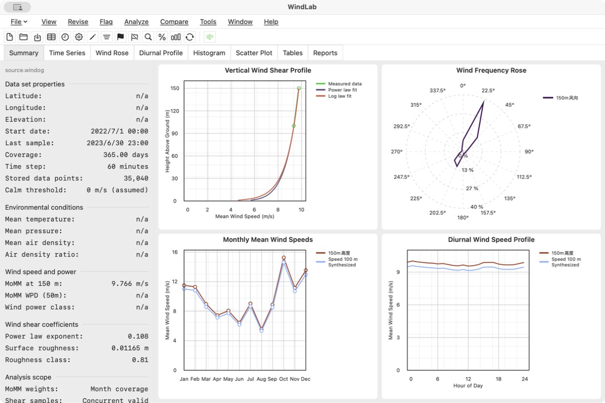
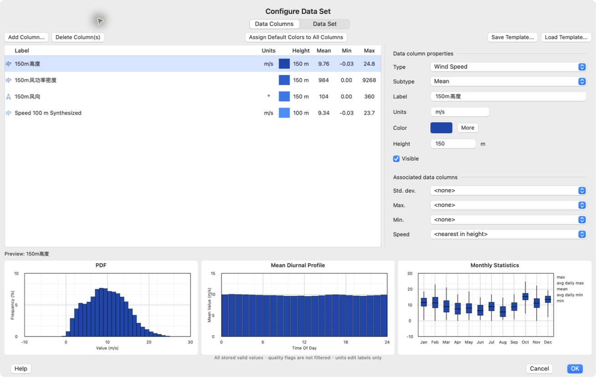
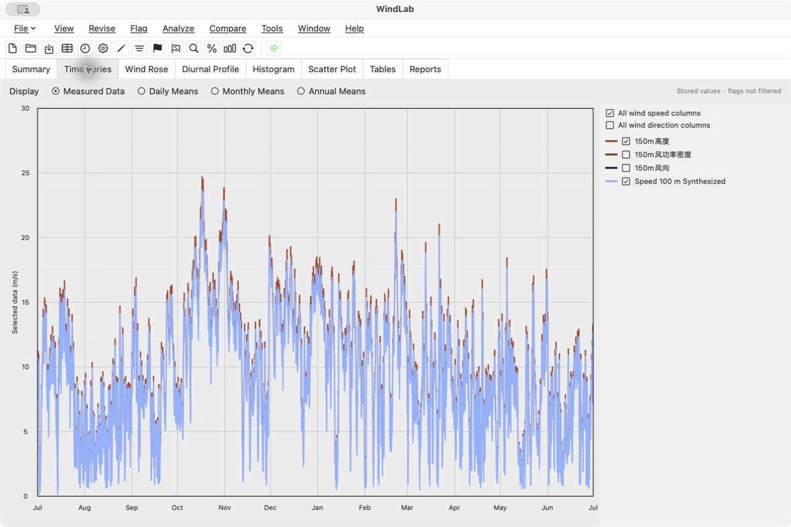
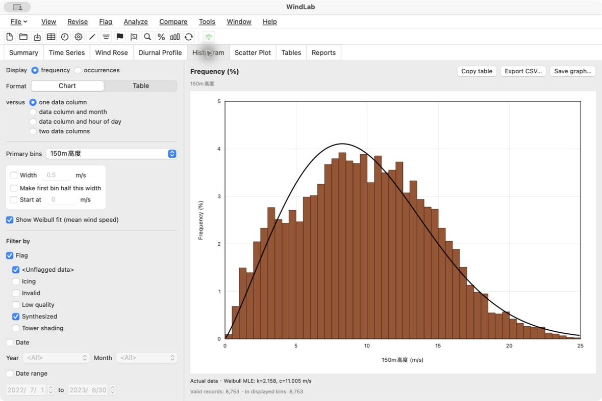
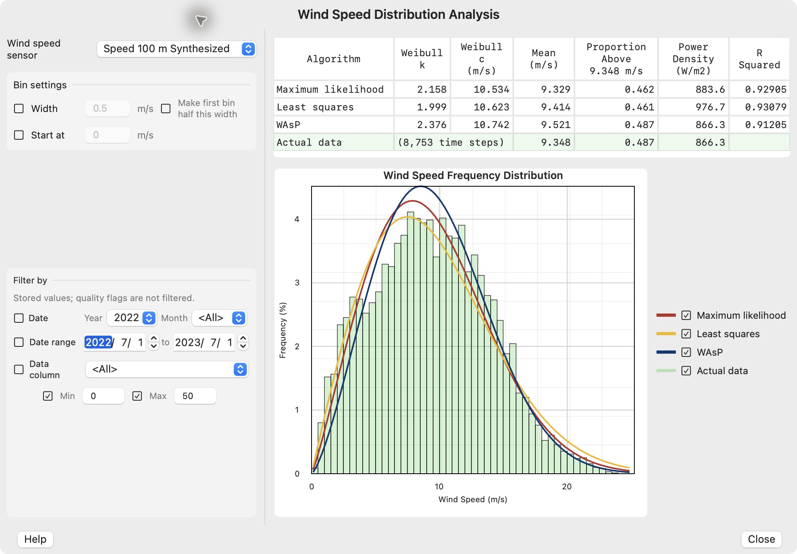

# WindLab

WindLab 是使用 **Swift / SwiftUI** 开发的 macOS 风资源数据分析应用，目前处于持续完善阶段。已有测风文件读取、文本导入、核心统计及可视化能力，功能仍在持续完善中。

**进展更新：2026-10-27。** 应用、构建和测试已移除 Python 依赖；提交前于 2026-10-27 重新执行完整回归，**116 项测试通过，0 失败**。本次文档与版本整理没有变更业务算法。

## 已实现的模块

| 模块 | 当前可用内容 |
|---|---|
| 文件读取与文本导入 | Swift 读取已支持结构的 `.windog`；导入 TXT、CSV、TSV，识别 UTF-8、UTF-16、GB18030 和部分旧式单位编码；时间缺口补为缺测值 |
| 数据集配置 | 文本导入后自动弹出配置；编辑类型、子类型、标签、单位标签、高度、颜色、可见性及关联列；支持本地 JSON 元数据模板、常数/线性计算列和静态副本 |
| 配置统计预览 | 全量有效数据的均值/最小/最大、15～40 箱 PDF、24 小时均值、月统计图；月图箱边采用平均每日最小/最大值，不是四分位数 |
| Summary | 数据属性、环境量、最高测高的覆盖加权月均值均值（MoMM）、风切变及粗糙度；风切变廓线、风频玫瑰、月均风速和日变化四图 |
| Time Series | 测量值、日/月/年统计；多列选择、缩放和缺测断线；绘图按可见范围保留局部极值，统计仍使用完整数据 |
| Wind Rose | 次数、频率、均值、最小/最大、样本标准差、风能占比和散点；方向、月份、两小时段和数值分箱等分组；表格、CSV、复制和 PNG 导出 |
| Histogram | 单列、按月、按小时及双列统计；次数/频率、分箱、图表/表格、双列表面投影/热图；CSV、复制和 PNG 导出 |
| 风速分布分析 | 最大似然、最小二乘和 WAsP 威布尔拟合对比；形状/尺度参数、均值、超越比例、功率密度和拟合评价 |
| 数据导出 | TXT、普通 CSV、TSV、现代 Excel XLSX、基础 WAsP TAB；列选择、时间范围及相关缺测值选项 |
| 原生构建与验证 | SwiftPM 构建、macOS `.app` 打包和本地签名；独立 CSV、ZIP/XML 导出校验；打包时检查无 Python 文件、运行库和旧启动入口 |

### 当前统计与交互约定

- 新 TXT/CSV/TSV 导入先进入配置草稿，确认后才替换当前数据；取消保留原数据。
- 配置、预览与后续分析共用 Swift 数据模型。修改单位字段仅修改标签，不会隐式转换原始样本；数值转换可使用计算列。
- Histogram、Wind Rose 已使用解码后的原生质量标记执行 Include 筛选，可与日期和数值条件组合。
- Histogram 月份/小时曲线显示组内频率，表格显示全局联合频率；两者分母不同，页面已明确标注。
- Summary 的 50m 风功率密度、风功率等级等结果依赖可用的测量数据和元数据。未知或无法可靠求值的内容显示 `n/a`，不伪造默认测量值。
- 已修复经纬度 `N/E` 被误判为风向的问题；可识别 `WD_...` 等风向列名及旧式度数符号。

## 部分实现的模块与限制

| 模块 | 已有能力 | 尚缺内容 |
|---|---|---|
| `.windog` 保存 | 保存既有支持档案，修改列标签/单位，保留未解析字节 | 从 TXT 创建完整原生档案；类型、高度、关联、颜色和计算列等完整配置写回 |
| 配置与派生计算 | 当前会话内的配置、本地 JSON 模板、常数/线性列及静态副本 | 原版专有模板、完整公式引擎、零存储派生列求值及全部传感器关联元数据 |
| 质量标记 | 原生标记读取；Histogram/Rose 的 Include 筛选 | 全局统一筛选、完整 Exclude 控件，以及标记创建、编辑、撤销和写回 |
| 图形与偏好 | 主要图表、部分样式、表格和图片导出 | 原版全部三维绘图、图形属性和交互细节；完整时序偏好设置 |
| 导出 | 通用表格、XLSX 和基础 WAsP TAB | 标记筛选、重采样及完整日期格式选项；TAB 季节校正、首仓半宽及专业软件协议 |


## 未实现的模块

| 类别 | 未实现内容 |
|---|---|
| 独立页面 | **Diurnal Profile、Scatter Plot、Tables、Reports**：目前仍为空白页；Summary 的日变化小图、Histogram/Rose 内的表格不等于这些页面已完成 |
| 数据修订 | 校准、批量缩放/偏移、时间平移、删除数据、缺测填补、量化修正、风速仪合并、垂直外推及完整撤销流程 |
| 标记编辑 | 手动/规则/散点图/塔影标记、标记定义、查看移除及写回 |
| 比较与长期订正 | 数据集比较、MCP（测量—相关—预测） |
| 机组与发电量 | 风机库、功率曲线、机组输出和发电量估算 |
| 高级分析 | 湍流、风速比、塔架畸变、温度廓线、入流角、长期分析、超越概率、极端风、代表年和预测误差等独立工具 |
| 专用查看器 | 数据覆盖、文档历史、DMap、通用箱线图和累计分布函数 |
| 文件组织与数据库 | 原生数据集新建、文件夹批量导入、追加/合并及数据库导入导出 |
| 专业导出 | WindSim、Meteodyn、Openwind 专用 CSV、WTI、INP、SAM SRW、XML 等协议 |
| 其他界面入口 | 部分菜单、工具栏、Help、Map 仍为空动作或禁用；不能按可见按钮数量统计完成功能 |


## 近期进展

| 阶段 | 已完成内容 |
|---|---|
| 文件与导出 | `.windog` 容器读取和受限保存迁移到 Swift，增加 TXT/CSV/TSV/XLSX/TAB 导出 |
| 统计核心 | Summary、Time Series、Histogram、Wind Rose、威布尔拟合迁移到 Swift，补齐实际筛选、分组、表格及图片输出 |
| 配置与导入 | 配置统计使用全量数据；修正月图箱边算法；文本导入共用配置流程，取消可回退 |
| 界面与识别 | 优化长列名、关联名称、图例和配置窗口布局；修正经纬度误作风向及旧式单位编码识别 |
| Python 清理 | 移除旧解析器、桥接、资源包、项目配置和虚拟环境；测试不再调用 Python，116 项完整回归通过 |
| 当前文档 | 区分已实现、部分实现和未实现模块，整理构建、验证及后续工作边界 |

## 软件截图

以下截图于 **2026-10-27** 采集自当前安装版，使用工作区样例 `source.windog`。样例不保证随仓库分发；未知场址和环境字段显示 `n/a`。截图展示当前可用界面，不代表所有可见菜单或标签页都已实现。

### Summary：数据概览与四项图形



### Configure Data Set：列配置与统计预览

TXT、CSV、TSV 导入也使用此配置流程，支持确认应用或取消回退。



### Time Series：多列测量值



### Histogram：频率分箱与拟合



### Wind Speed Distribution Analysis：三种拟合对比

此图选择 100m 合成风速列，Histogram 截图选择 150m 风速列，参数不同属于不同输入列的结果。



## 使用与构建

要求：macOS 14 或以上，以及支持 Swift 6.1 的 Xcode/Command Line Tools。应用运行不需要 Python。

```bash
cd app/WindLabMac

# 调试构建
swift build

# 测试
swift test

# 默认构建 Release，并打包为 macOS 应用
./scripts/package_app.sh

# 启动打包后的图形应用
open ./dist/WindLab.app
```

调试版应用包可用 `WINDLAB_BUILD_CONFIGURATION=debug ./scripts/package_app.sh` 构建。若当前受限环境不能运行 SwiftPM 的嵌套沙箱，可为测试增加 `--disable-sandbox`，或为打包设置 `WINDLAB_SWIFTPM_DISABLE_SANDBOX=1`。打包结果为本地 ad-hoc 签名，不是公证发行版本。

在应用中通过 **File → Open** 打开 `.windog`、TXT、CSV 或 TSV；通过 **File → Export Data…** 导出数据。TXT 不能直接另存为完整原生 `.windog`，编辑配置也不代表所有属性都可写回源档案。

最近一次完整测试结果来自现有本地测试语料；部分语料不随仓库提供，其他环境运行时可能跳过相应检查。

## 项目结构与详细说明

```text
app/WindLabMac/
  Sources/WindogCore/       文件编解码、统计核心、文本导入及导出
  Sources/WindLabMac/       SwiftUI 界面与应用数据协调
  Tests/                   核心及页面集成测试
  scripts/package_app.sh   打包、签名及原生依赖检查
  assets/                  应用图标
docs/screenshots/          当前安装版的实际界面截图
```

- [应用开发与验证说明](app/WindLabMac/README.md)

